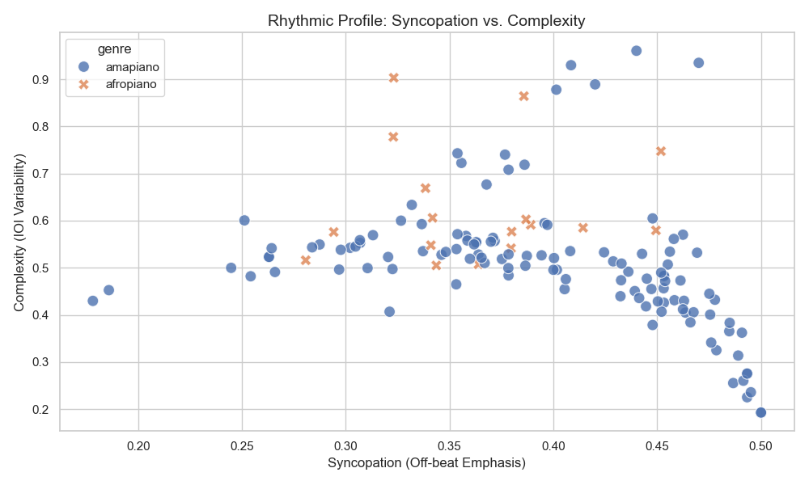
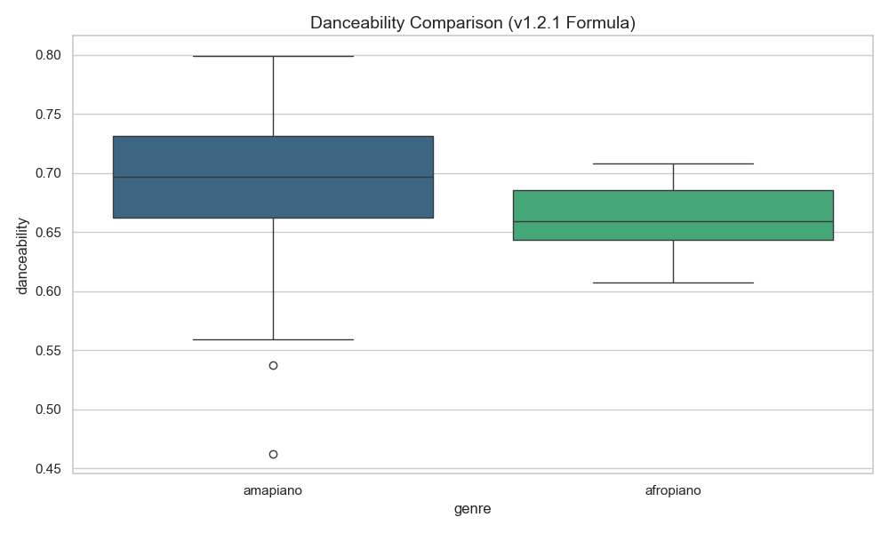
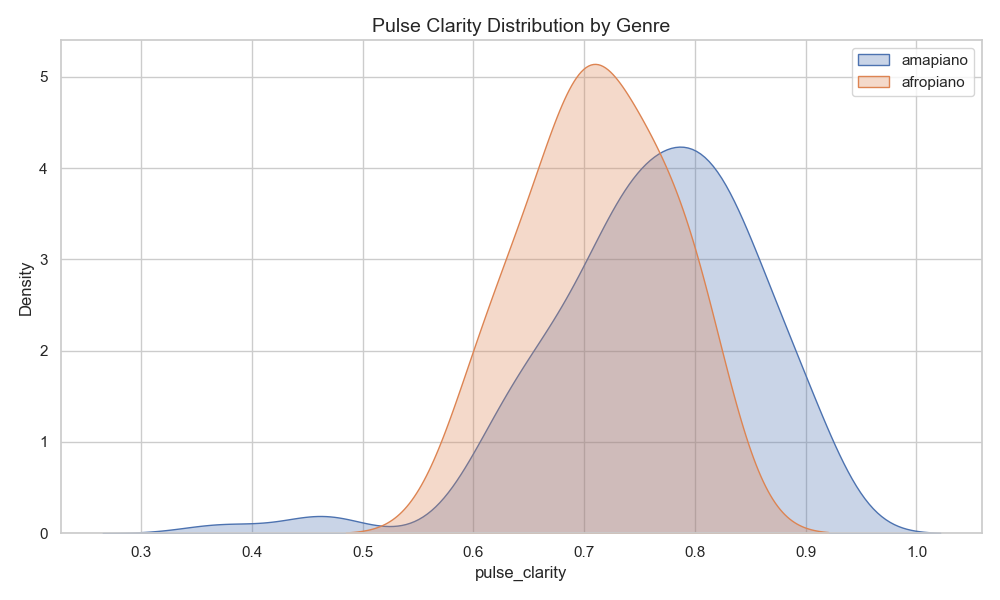

# MIR Batch Analysis Report
    
Generated on: 2026-05-05 23:56
Total Tracks: 137
Genres: amapiano, afropiano

## Genre Statistics (Means)

| genre     |     bpm |   complexity |   syncopation |   pulse_clarity |   log_drum |   danceability |
|:----------|--------:|-------------:|--------------:|----------------:|-----------:|---------------:|
| afropiano | 108.5   |     0.629229 |      0.3639   |        0.711376 |   0.976324 |       0.660118 |
| amapiano  | 113.199 |     0.506921 |      0.395385 |        0.761291 |   0.962307 |       0.691725 |

## Interpretation
- **Amapiano** typically shows higher **Syncopation**, **Log Drum Intensity**, and **Complexity** than Standard Pop.
- **Pulse Clarity** and **Log Drum Presence** are the strongest drivers of the v1.3.0 Danceability score.
- Tracks with high syncopation (>0.3) but low pulse clarity are often complex/polyrhythmic but might have a 'loose' groove.

## Visualizations

---
*Results generated by analyze_track.py v1.3.0*
