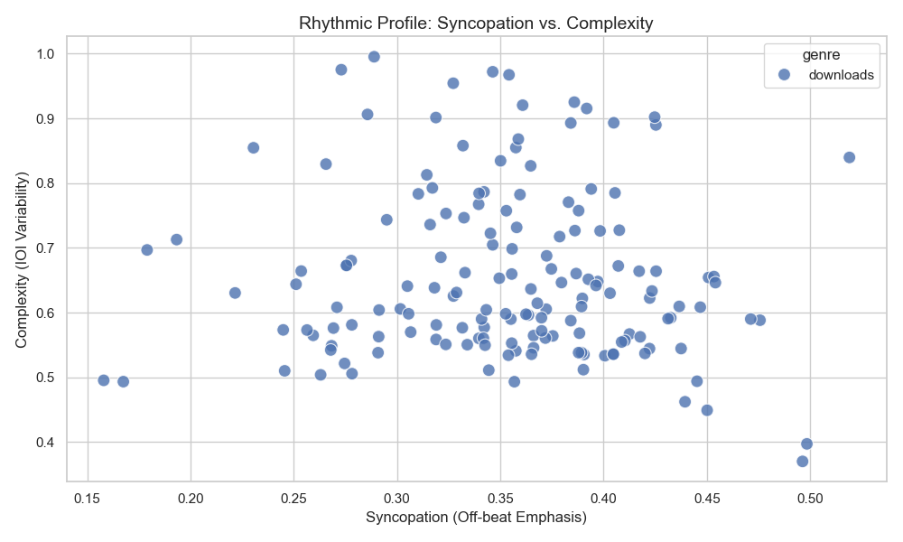
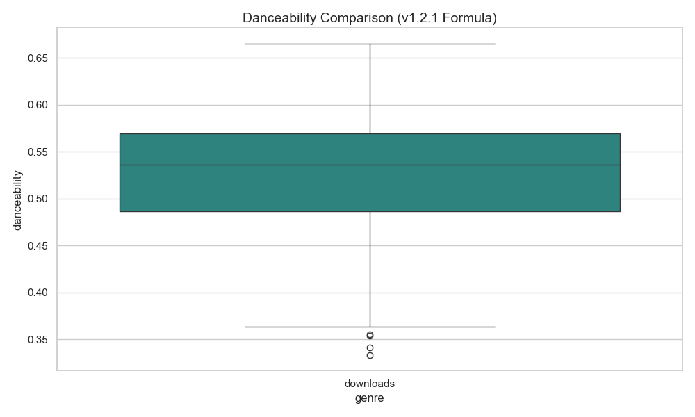
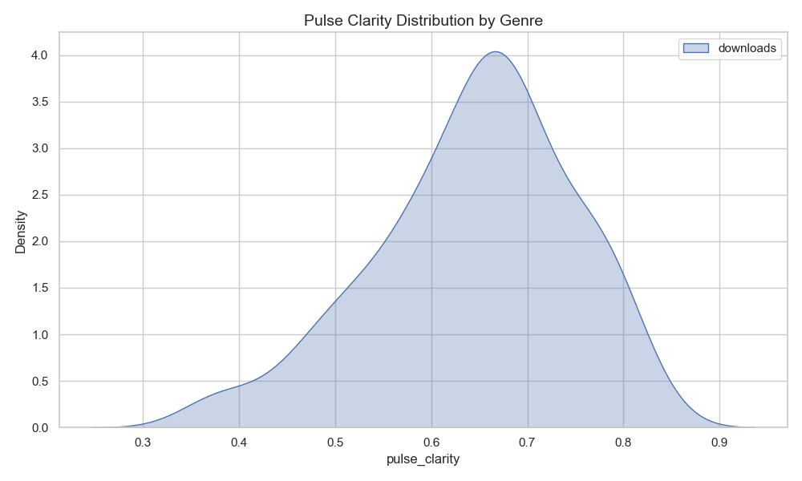

# MIR Batch Analysis Report
    
Generated on: 2026-04-07 13:12
Total Tracks: 157
Genres: downloads

## Genre Statistics (Means)

| genre     |     bpm |   complexity |   syncopation |   pulse_clarity |   danceability |
|:----------|--------:|-------------:|--------------:|----------------:|---------------:|
| downloads | 108.764 |     0.654698 |      0.353436 |         0.64398 |       0.527762 |

## Interpretation
- **Amapiano** typically shows higher **Syncopation** and **Complexity** than Standard Pop.
- **Pulse Clarity** is the strongest driver of the v1.2.1 Danceability score.
- Tracks with high syncopation (>0.3) but low pulse clarity are often complex/polyrhythmic but might have a 'loose' groove.

## Visualizations

---
*Results generated by analyze_track.py v1.2.1*
